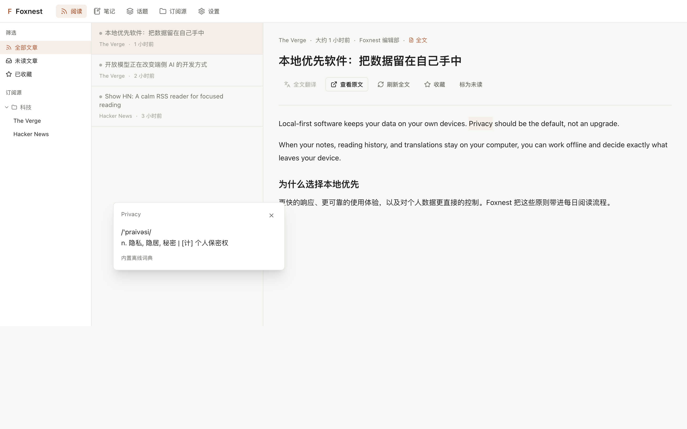
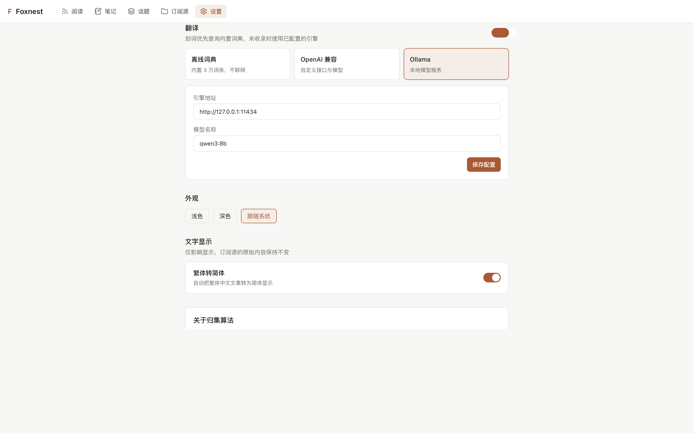

# Foxnest

一个带「重复话题归集」能力的本地优先 RSS 阅读器。不同订阅源对同一事件的报道会被自动聚合成一个话题卡片，避免信息流被重复内容淹没。

## 界面预览





## 技术栈

| 层 | 选型 |
| --- | --- |
| 桌面外壳 | Tauri 2（Rust） |
| 前端 | React 19 + TypeScript（strict） |
| 构建 | Vite 8 + pnpm |
| 样式 | Tailwind CSS 4 + shadcn/ui 风格组件 |
| 状态 | Zustand |
| 存储 | SQLite（Tauri SQL 插件） |
| 数据源 | RSS/Atom、Miniflux REST API、FreshRSS（Google Reader 兼容 API）、OPML 导入导出 |

## 启动

```bash
pnpm install
pnpm tauri dev        # 开发模式（启动桌面窗口）
pnpm build            # 仅构建前端
pnpm tauri build      # 构建可分发桌面应用
```

首次启动会自动在应用数据目录创建 `foxnest.db`。

## 核心功能

### 话题归集
新文章入库后依次经过三层判定：

1. **精确去重**：canonical URL（去掉 utm 等追踪参数）+ SimHash 指纹，完全相同的内容直接跳过
2. **实体锚点**：抽取品牌、产品、机构类高价值词作为强信号，两个共享锚点即可越过聚合阈值
3. **标题相似度 + 时间窗**：Jaccard / 编辑距离 / 实体重合加权，且只在设定时间窗内比较

**会话级话题与手动整理**：
- 自动话题只保存在内存中，每次启动都会按当前文章和时间窗重新归集，不会让过期新闻一直留在话题流
- 手动拆分自动话题后，其余文章会保存为手动话题；手动合并后，目标话题也会持久化
- 手动话题及其文章关系保存在 SQLite 中，重启后继续保留
- 解散自动话题只影响本次会话，解散手动话题会删除其持久化记录
- 三档聚合强度：保守 / 标准 / 激进
- 可调时间窗：12h – 168h
- 时间流 / 话题流双视图随时切换

### 划词笔记
- 阅读文章时划选正文，点击浮动的「存为笔记」即可保存
- 独立笔记页按时间倒序展示摘录、来源文章和保存时间
- 可从笔记直接打开原文，也可随时删除

### 自动刷新
- 默认启动软件后自动刷新一次，之后每 30 分钟更新订阅源
- 可在设置中选择 15 / 30 / 60 分钟或关闭自动刷新
- 手动刷新在「订阅源」中按单个订阅源进行，只更新点击的源
- 自动刷新与手动刷新共用防重入逻辑，不会并发抓取同一批订阅源

### 划词与全文翻译
- 内置 3 万词条离线词典，划词查询优先使用词典，不联网
- 离线词典未收录时，可使用 OpenAI 兼容接口或本地 Ollama 翻译
- 阅读器支持划词翻译、全文翻译、进度提示和原文/译文切换
- 在线引擎地址、模型和 API Key 可在设置中配置，密钥保存在系统钥匙串
- 内置词典来源于 ECDICT，授权文本随应用附带

### 数据源
- 直接添加 RSS/Atom URL
- Miniflux：填服务地址 + API Token
- FreshRSS：填服务地址 + 授权 Token（Google Reader 兼容接口）
- OPML 批量导入导出，支持文件夹层级

## 目录结构

```
src/
├── types/               # 领域类型（Feed / Article / Topic / Note / Settings）
├── lib/                 # db.ts（SQLite + Rust fetch 桥接）、工具函数
├── shared/ui/           # 通用 UI 组件（Button / Input / Badge）
├── store/               # Zustand 全局状态与应用动作
└── features/
    ├── feeds/           # 订阅源管理、RSS/API 抓取、OPML
    ├── articles/        # 文章仓储、列表、阅读器
    ├── notes/           # 划词笔记仓储与笔记页
    ├── translation/     # 离线词典与在线翻译服务
    ├── clustering/      # 归集引擎（tokenizer / similarity / clusterEngine / topicRepo）
    └── settings/        # 设置面板与持久化
```

## 后续接入 Embedding 模型

规则版的边界：单锚点语义相近但措辞完全不同的报道（如「暴雨预警」vs「气象局发布暴雨红色预警信号」）无法可靠聚合。接入模型时的替换点：

- `src/features/clustering/tokenizer.ts` 的 `extractAnchors` → 替换为 Embedding 向量生成
- `src/features/clustering/similarity.ts` 的 `headlineSimilarity` → 替换为向量余弦相似度
- `clusterEngine.ts` 的判定逻辑不变（阈值 + 时间窗 + 锚点/向量分数）

可选方案：本地轻量模型（all-MiniLM-L6-v2 等，隐私优先）或云端 API（效果好但有成本）。建议采用「规则先筛候选 → 模型精判」的混合策略以控制成本。

## 已知限制

- RSS 正文解析依赖订阅源提供 content，纯摘要源只能显示摘要并跳转原文
- FreshRSS 的 Google Reader 兼容 API 在不同版本间字段名可能有差异
- 规则版聚类对中文语义相近但无共享专名的报道覆盖有限

## 实现说明

- **XML 解析用 WebView 原生 `DOMParser`**，不依赖 `rss-parser`/`xml2js`。原因是 xml2js 内部调用 Node 的 `EventEmitter.removeAllListeners()`，在 Tauri 的 WKWebView 中不存在，会在解析时抛错、导致刷新永远卡在"更新中"。DOMParser 方案零依赖且同时兼容 RSS 2.0 与 Atom。
- 网络请求统一走 Rust 侧 `fetch_url` / `post_json` 命令（`reqwest`），绕开 WebView 的跨域限制，并支持自定义 Header（Miniflux / FreshRSS 鉴权、在线翻译请求）。
- Miniflux / FreshRSS Token 与在线翻译 API Key 保存在系统钥匙串中，前端只在刷新或翻译时临时读取；旧版数据库中的明文 Token 会在首次启动时自动迁移并清空。
- 数据库建表、迁移和去重清理在单个事务中执行，任一步失败都不会留下半初始化状态。
- 刷新流程带 `try/finally`，任何异常都会释放 busy 状态并把错误显示在提示条，不会让界面永久卡死。
